[English](README.md) · [Português](README.pt-BR.md) · [Español](README.es.md) · **Tiếng Việt**

<a id="top"></a>

<p align="center">
  <a href="#cai-dat"></a>
</p>

<h1 align="center">nhipdung</h1>

<p align="center"><strong>Bạn yêu cầu. Video thêm nhịp nhàng.</strong></p>

<p align="center"><em>nhipdung</em> (<em>Nhịp Dựng</em>, "nhịp điệu của bản dựng") là bản fork của <a href="https://github.com/soumatheusgomes/editonny">editonny</a> do Matheus Gomes tạo ra, bổ sung hỗ trợ tiếng Việt.</p>

<p align="center">Skill dựng video miễn phí, mã nguồn mở cho <strong>Claude Code</strong> và <strong>Codex</strong>. Cắt khoảng lặng và chỗ nói vấp, thêm phụ đề, chỉnh âm thanh, đổi khung hình và biến những đoạn lời nói thành cảnh chuyển động chỉ bằng cách yêu cầu bằng ngôn ngữ đời thường. Việc chép lời và render đều chạy trên máy tính của bạn.</p>

<p align="center">
  <a href="https://github.com/ducnhanle/nhipdung/stargazers"></a>
  <a href="https://github.com/ducnhanle/nhipdung/actions/workflows/verify.yml"></a>
  <a href="LICENSE.md"></a>
  
  
</p>

<p align="center"><a href="#cai-dat"><strong>Cài đặt bằng một yêu cầu</strong></a> · <a href="#cach-hoat-dong">Cách hoạt động</a> · <a href="#thu-nghiem">Thử nghiệm</a> · <a href="#chuyen-dong">Cảnh chuyển động</a> · <a href="#mo-trang-huong-dan">Trang hướng dẫn</a> · <a href="#cong-dong">Lịch sử sao</a></p>

<p align="center"></p>

<a id="cai-dat"></a>

## Cài đặt bằng một yêu cầu

Bạn không cần tự tải gì về. Mở **Claude Code** hoặc **Codex** ở bất kỳ thư mục nào và dán yêu cầu này. Cùng một yêu cầu sẽ cài nhipdung lần đầu và cập nhật về sau: agent của bạn clone skill từ GitHub, làm theo quy trình thiết lập, xác minh mọi thứ và hỏi bạn trước khi làm bất cứ việc gì nằm ngoài yêu cầu.

```text
Hãy cài đặt hoặc cập nhật skill nhipdung cho Codex và Claude Code từ https://github.com/ducnhanle/nhipdung. Clone phiên bản mới nhất vào một thư mục tạm; tôi sẽ không tự tải gì về. Đọc skills/nhipdung/SKILL.md và làm theo toàn bộ quy trình thiết lập trong đó. Nếu nhipdung đã được cài, hãy so sánh các phiên bản, tóm tắt những gì thay đổi và cập nhật theo đúng phương thức cài đặt hiện tại: trình cài đặt của kho mã cho bản cài đặt dùng chung (trình này giữ nguyên các cài đặt của tôi và sao lưu bản trước đó) hoặc trình cập nhật của host cho plugin được quản lý. Trước lần dựng đầu tiên, hãy chuẩn bị các công cụ cục bộ tương thích, engine đã khóa phiên bản, trình render và trình duyệt đã ghim phiên bản, mô hình chép lời mặc định, OCR cục bộ để kiểm tra phụ đề và tệp media đi kèm. Xác minh bằng công cụ chẩn đoán và một đoạn mẫu tổng hợp, báo lại mọi mục còn dang dở, xóa bản clone tạm và cho tôi biết khi nào cần khởi động lại agent của tôi. Hãy hỏi tôi trước khi dùng dịch vụ trả phí hoặc gửi các tệp media của tôi đi.
```

<p align="center"></p>

Khi hoàn tất, hãy khởi động lại agent và gọi **`/nhipdung` trong Claude Code** hoặc **`$nhipdung` trong Codex**. Đây cũng chính là yêu cầu mà trang hướng dẫn sao chép cho bạn.

| Bạn sẽ cần | Phiên bản |
|---|---|
| Claude Code hoặc Codex | Đã được thiết lập |
| Python | 3.9+ cho trình khởi chạy; engine dùng >=3.10,<3.14 qua uv |
| uv | Trình quản lý Python |
| FFmpeg và ffprobe | Có trong `PATH` |
| Node.js và npx | 22.13+ hoặc 24+ |
| OCR cục bộ để kiểm tra phụ đề | Apple Vision (macOS) hoặc Tesseract |

Agent sẽ chuẩn bị những gì còn thiếu, đồng thời báo các bản tải xuống còn chờ hoặc các bước kiểm tra bị lỗi trước khi xác nhận đã cài xong. Chép lời và render cục bộ không cần khóa API của LLM; gói thuê bao agent của bạn là khoản riêng. Các công cụ tạo nội dung bên ngoài là tùy chọn và cần bạn cho phép trước khi phát sinh chi phí hoặc gửi media đi.

<details>
<summary><strong>Thích dùng terminal hơn?</strong></summary>

```sh
git clone https://github.com/ducnhanle/nhipdung.git
cd nhipdung
python3 install.py --target both
python3 ~/.local/share/nhipdung/scripts/nhipdung.py doctor
python3 ~/.local/share/nhipdung/scripts/nhipdung.py media status
```

Dùng `--target codex` hoặc `--target claude` để chỉ đăng ký một agent. Bản cài đặt dùng chung nằm ở `~/.local/share/nhipdung`; mục của từng agent là liên kết trỏ đến đó. Các lệnh này đăng ký skill và chuẩn bị môi trường Python. Để thiết lập đầy đủ (trình render, trình duyệt, mô hình chép lời, OCR và các bước kiểm tra tổng hợp), hãy nhờ agent đọc `skills/nhipdung/SKILL.md` và làm theo [quy trình thiết lập (tiếng Anh)](skills/nhipdung/references/setup.md). Mỗi lần dùng, skill kiểm tra môi trường cục bộ và bản cập nhật trên GitHub; bản cập nhật chỉ được áp dụng khi bạn đồng ý.

Cài đặt tách biệt, nạp dưới dạng plugin, cập nhật và gỡ cài đặt: xem [hướng dẫn cài đặt và khôi phục (tiếng Anh)](docs/installation.md).

</details>

<a id="cach-hoat-dong"></a>

## Cách hoạt động

<p align="center"></p>

nhipdung là một skill cài trên máy tính của bạn. Bạn mô tả kết quả mong muốn và chỉ cho agent thư mục video; skill sẽ kiểm tra bản ghi, chọn những lần quay trọn vẹn, đo điểm cắt theo dạng sóng âm thanh, dựng thành một dự án, duyệt một đoạn mẫu tiêu biểu và xuất ra một tệp MP4 đã được kiểm tra.

```text
$nhipdung
Edit a 45-second vertical video from /path/to/footage.
Keep complete takes, clean pauses, breaths, and mistakes, and add clear captions.
Use visual scenes only where they explain the story.
Verify an 8–15 second sample before finishing the export.
```

1. Chọn một mục tiêu trong trang hướng dẫn, chỉ định thư mục video gốc và sao chép yêu cầu (bằng ngôn ngữ của trang hướng dẫn) sang agent.
2. Skill kiểm tra các tệp nguồn đã chọn, đề xuất mọi thiết lập dựng và **chờ bạn xác nhận**, kể cả khi yêu cầu đã rất chi tiết. Mặc định giữ nguyên hình ảnh, kích thước khung và FPS gốc; bộ lọc màu và chuyển đổi màu không bao giờ được tự động áp dụng.
3. Sau khi bạn đồng ý, mọi thứ nằm trong **Downloads/nhipdung/ngày-tiêu-đề/**: video hoàn chỉnh ở **exports/**, tệp dựng ở **project/**. Hãy duyệt một đoạn mẫu **8–15 giây**; chọn để chính bạn duyệt nếu muốn agent chờ cả ở bước sau này.
4. Một quy trình render được hỗ trợ sẽ xuất các tệp MP4/phụ đề có tên riêng, kèm manifest xác minh tương ứng. Quy trình màu hoặc thời gian không được hỗ trợ sẽ bị chặn kèm giải thích rõ ràng; khi chạy từ xa, agent phải xác định một nơi lưu mà bạn truy cập được.

Dọn dẹp tiêu chuẩn loại bỏ các khoảng lặng không cần thiết, tiếng thở nghe rõ, chỗ nói vấp, chỗ nói hụt và những chỗ lặp lại thừa, đồng thời giữ trọn từng từ, nhịp nói tự nhiên, các khoảng lặng có chủ đích và ý nghĩa. Các bản sửa có phạm vi hẹp chỉ thay đổi trong phạm vi được yêu cầu. Video gốc được giữ nguyên, và lời nói có thể giữ nguyên ngôn ngữ gốc.

## Mỗi yêu cầu là một lớp

<p align="center"></p>

## Hai dịch vụ, một quy trình

<p align="center"></p>

<a id="thu-nghiem"></a>

## Đầu vào, yêu cầu, kết quả

<p align="center"></p>

<p align="center"></p>

<p align="center"></p>

<a id="chuyen-dong"></a>

## Lời nói hóa thành cảnh

<p align="center"></p>

<p align="center"></p>

Các cảnh lấy từ danh mục đi kèm gồm **145** cảnh chuyển động và **79** đoạn video gốc; mỗi dự án chỉ nhận những đoạn nó dùng. Các con số, ưu đãi, lời chứng thực và thương hiệu mẫu trong cảnh chỉ mang tính minh họa và phải được thay bằng thông tin thật do bạn cung cấp. Đừng bao giờ xem hình ảnh được tạo ra là bằng chứng. Mọi banner trong README này là hoạt ảnh minh họa quy trình, không phải bản render từ video của khách hàng.

<a id="mo-trang-huong-dan"></a>

## Mở trang hướng dẫn

Trang hướng dẫn là website của nhipdung: nó soạn yêu cầu dựng video, cho bạn xem 145 cảnh chuyển động và 54 yêu cầu mẫu, và hướng dẫn cài đặt bằng tiếng Việt, tiếng Anh, tiếng Bồ Đào Nha (Brazil) hoặc tiếng Tây Ban Nha (chọn theo ngôn ngữ của trình duyệt; lựa chọn và bản mô tả của bạn được lưu trong trình duyệt đó). Trang này không bao giờ nhận hay tải lên video.

Để chạy cục bộ từ kho mã này (Node.js 22.13+ hoặc 24+):

```sh
npm ci
python3 nhipdung.py guide
```

Lệnh này khởi động máy chủ phát triển ở `http://localhost:4173` và mở trang. Dừng bằng `Ctrl+C`; dùng `--port` để chọn cổng khác và `--no-open` để không mở trình duyệt. `npm run dev` làm điều tương tự ở cổng 3000.

## Cấu trúc

| Đường dẫn | Vai trò |
|---|---|
| `skills/nhipdung/` | Skill di động duy nhất và CLI |
| `skills/nhipdung/engine/` | Xử lý cục bộ, bản xem trước và mẫu dự án tiếng Anh |
| `skills/nhipdung/visuals/` | Cảnh, danh mục, media đi kèm và công thức |
| `web/` | Trang hướng dẫn công khai: ứng dụng Next.js với trình soạn yêu cầu, danh mục, ví dụ và hướng dẫn cài đặt bằng bốn ngôn ngữ |
| `DESIGN.md` | Quy chuẩn thiết kế và nguồn gốc của các design token |
| `design-system/` | Thư viện component React, token, mẫu bản xem trước, showcase và HTML tham chiếu |
| `docs/` | Tài liệu chuẩn (tiếng Anh) về kiến trúc, cài đặt, tích hợp và kiểm chứng |
| `scripts/`, `tests/` | Đóng gói, hình minh họa README, kiểm tra render và kiểm thử hồi quy |

Dự án mới dùng `project.json` cùng các lệnh, trường dữ liệu và ID cảnh bằng tiếng Anh. Đây là nền tảng sạch trước khi phát hành; các định dạng dự án thử nghiệm trước đây không được hỗ trợ.

<details>
<summary><strong>Phát triển, kiểm chứng và phân phối</strong></summary>

## Phát triển và kiểm chứng

```sh
npm ci --ignore-scripts
uv sync --locked --directory skills/nhipdung/engine
npm run build
npm run check
python3 nhipdung.py doctor
npm run test:engine
npm run test:browser
npm run test:preview
npm run test:scenes
npm run test:three
python3 scripts/smoke_engine.py
```

`npm run test:browser` build trang hướng dẫn rồi chạy Playwright (cài Chromium của Playwright một lần bằng `npx playwright install chromium`). Các bài kiểm tra trình duyệt cho bản xem trước và 3D (`npm run test:preview`, `npm run test:three`) cần `agent-browser`. Kiểm tra render cần FFmpeg và mạng ở lần đầu dùng HyperFrames. Hãy xem các đoạn mẫu đã tạo trước khi xóa kết quả tạm trong `.work/`. Lệnh đầy đủ, kết quả và giới hạn đã biết nằm trong [tài liệu kiểm chứng (tiếng Anh)](docs/validation.md).

Kho mã là một npm workspace: `web/` (`@nhipdung/web`) và `design-system/` (`@nhipdung/design-system`). `npm run build` build trang hướng dẫn; `npm run check` chạy lint, kiểm tra kiểu, kiểm thử đơn vị và kiểm tra danh sách icon (`npm run icons` tạo lại danh sách này từ `design-system/assets/icons/`). Mở `/design-system` trên trang hướng dẫn đang chạy để xem mọi component và trạng thái ở cả hai giao diện; giao diện mới tuân theo [DESIGN.md](DESIGN.md) và [bản đồ thư viện](design-system/README.md).

Các banner của README được tạo từ nội dung giao diện của trang hướng dẫn và các token trong DESIGN.md: chạy `npm run readme:art` sau khi thay đổi một trong hai. `npm test` báo lỗi khi có banner đã lỗi thời, và yêu cầu cài đặt trong mỗi README phải khớp với trang hướng dẫn.

### Triển khai trang hướng dẫn

Nhập kho mã vào Vercel và đặt **Root Directory** là `web`; Vercel cài workspace từ thư mục gốc của kho mã và giữ danh mục của skill sẵn sàng cho bản build. Đặt `NEXT_PUBLIC_SITE_URL` thành địa chỉ công khai (ví dụ một tên miền riêng) để liên kết canonical, `hreflang`, sitemap, dữ liệu có cấu trúc và ảnh chia sẻ theo từng ngôn ngữ dùng địa chỉ đó; nếu không đặt, tên miền production của Vercel sẽ được dùng.

## Đóng gói

```sh
python3 scripts/package.py
```

Lệnh này tạo tệp ZIP của plugin kèm tệp SHA-256 trong `dist/`. Gói gồm tài liệu chuẩn, toàn bộ skill và **79 video đi kèm**; mỗi dự án chỉ nhận những đoạn nó dùng. Trang hướng dẫn được triển khai thành website thay vì nằm trong gói. Việc đóng gói không xuất bản gì và không thay đổi bản cài đặt toàn máy của bạn.

</details>

<a id="cong-dong"></a>

## Theo dõi hành trình

Nếu nhipdung giúp ích cho video tiếp theo của bạn, hãy tặng dự án một ngôi sao. Theo dõi tiến độ, báo lỗi hoặc chia sẻ ý tưởng cho một cảnh mới.

<a href="https://www.star-history.com/?repos=ducnhanle%2Fnhipdung&amp;type=date">
  <picture>
    <source media="(prefers-color-scheme: dark)" srcset="https://api.star-history.com/chart?repos=ducnhanle/nhipdung&amp;type=date&amp;theme=dark" />
    
  </picture>
</a>

[Tặng sao cho dự án](https://github.com/ducnhanle/nhipdung/stargazers) · [Báo lỗi](https://github.com/ducnhanle/nhipdung/issues) · [Mở lịch sử sao](https://www.star-history.com/?repos=ducnhanle%2Fnhipdung&type=date)

Lịch sử sao trực tiếp do [Star History](https://www.star-history.com/blog/how-to-use-github-star-history/) cung cấp và phụ thuộc vào dịch vụ đó. Huy hiệu ở trên hiển thị số sao thật trên GitHub.

## Tác giả và liên hệ

Bản fork này do **ducnhanle** duy trì. Bản fork bổ sung hỗ trợ tiếng Việt, đồng thời được cài đặt và cập nhật từ chính kho mã của mình.

- GitHub: [ducnhanle](https://github.com/ducnhanle) · [ducnhanle/nhipdung](https://github.com/ducnhanle/nhipdung)
- Lỗi của bản fork này: [issues](https://github.com/ducnhanle/nhipdung/issues)
- Nhật ký thay đổi: [docs/fork-log.vi.md](docs/fork-log.vi.md)

nhipdung dựa trên **editonny**, do **Matheus Gomes** tạo ra:

- Email: [eu@matheusgom.es](mailto:eu@matheusgom.es)
- GitHub: [soumatheusgomes/editonny](https://github.com/soumatheusgomes/editonny)

## Giấy phép và tài nguyên

Mã nguồn và tài liệu của dự án dùng [Giấy phép MIT](LICENSE.md). Thư viện, mô hình, phông chữ, âm thanh và media của bên thứ ba giữ nguyên giấy phép và yêu cầu ghi công riêng; giấy phép MIT không áp lên các tài nguyên đó. Hãy xem [thông báo về bên thứ ba](skills/nhipdung/engine/THIRD_PARTY_NOTICES.md) và các thông báo đặt cạnh tài nguyên trước khi phân phối lại.

Tài liệu tiếng Anh: [Sản phẩm](PRODUCT.md) · [Kiến trúc](docs/architecture.md) · [Giao diện](docs/design.md) · [Tích hợp](docs/integrations.md) · [Thiết lập môi trường phát triển](docs/setup.md)

<p align="center"><strong>BẠN CÓ CÂU CHUYỆN. CHÚNG TÔI LO PHẦN NHỊP ĐIỆU.</strong><br /><a href="#top">Về đầu trang ↑</a></p>
